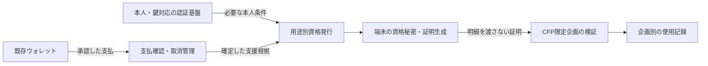

# ADR-0023: JPKI認証ウォレットと匿名支援資格

**状態:** 提案
**日付:** 2026-11-20
**最終更新日:** 2026-11-20

## 1. 背景と対象

ホワイトペーパーの2026年11月20日改訂（コミット`55fb56750527c05458c57b6a497a5fc592e78dbd`）は、JPKIプロジェクトの本人・鍵・権限・同意の分離と、支援・視聴履歴のプライバシー要件をCFPへ統合した。本ADRはその対応方針を記録する。実装・独立監査・正式提携・法令適合を完了したという決定ではない。

既存のJPKI結合、公開SBT、透明型ZKPの設計には、匿名資格をサービス間で提示する場合の追加境界が必要である。本人確認を強化しても、それだけで支援履歴が保護されるわけではない。公開ウォレットや共通IDを提示し続ければ、証明から秘密を隠しても活動を関連付けられる。

対象は、外部支援サービスで得た資格をCFPの限定企画で提示する構成と、それを支える認証・失効・資産の境界である。独自ウォレットアプリ、秘匿送金、本番ガバナンスの置換、実JPKI・JPYC・SonoLoop API接続の承認は対象外とする。

## 2. 決定案

### 2.1 認証ウォレットを構成の統合として扱う

既存ERC-20ウォレットを資金・署名用に使い、外部のJPKI認証基盤、パスキー、プラットフォームアカウント、資格管理を接続する。マイナンバーカードの鍵を送金鍵に変換しない。ウォレットの秘密鍵をNPOが預かることを既定にしない。

| 主体・機能 | 担当 | 境界 |
| --- | --- | --- |
| NPO認証基盤（構想） | 本人確認根拠、主体・鍵対応、登録同意、復旧・失効 | 本人情報を保護し、支援・再生の全履歴を集約しない |
| パスキー | 日常認証、重要操作の追加確認 | 生体方式・端末固定・法的権利を保証しない |
| 外部ウォレット | ユーザが確認した送金・署名 | 認証アカウントの復旧と資産の復旧は別 |
| SonoLoop等（連携候補） | 支援実績、取消、資格発行の根拠 | 正式なAPI・契約は未確定。明細の一括共有を前提にしない |
| CFP | 利用実績、権利、分配、企画参加 | 受け入れる発行者・資格用途・条件を明示する |
| 各運営主体 | 法務、決済、会計、権利審査、紛争対応 | ZKPやNPOの認証で責任を代替しない |

JPKIを通常の再生・全支援へ必須化しない。必要な場面で本人確認の根拠を取得し、本人確認VC、鍵束縛VC、作品別権利・委任VC、支援資格を分ける。ログインやアカウント連携への同意を、許諾・送金・履歴共有への包括同意と扱わない。

### 2.2 支払・資格発行・匿名提示を分離する

支払は資産・チェーン・宛先・金額・イベント位置・確定状態を確認し、同じ支払から重複発行しない。匿名提示では、承認された資格の保有、有効状態、企画条件、対象操作を検証する。発行者の確認が誤っていればZKPだけでは補正できない。

nullifierはサービス・企画・用途ごとに範囲を固定し、同一企画の二重利用を原子的に拒否する。別企画で共通の追跡IDとして使わない。期限、要求、投票内容への拘束と再送時の結果を定義する。「一資格一回」と「一人一回」は区別し、後者には発行・再発行の重複管理を追加する。資格貸与や共謀の完全排除を保証しない。

匿名提示に共通DID、会員ID、送金元、取引IDを必須にしない。必要なログインは資格取得側で扱い、匿名の提示先へ認証セッションを無条件に引き継がない。証明を別サーバーで生成するときは、そこで開示される秘密と保存方針を明示する。

### 2.3 失効・返金・復旧を資格の一部として設計する

返金、支援取消、期限切れ、鍵漏えいを資格状態に反映する。許可する集合・状態の版と鮮度を定め、古い証明で取消を迂回させない。状態照会自体による利用先の追跡も評価する。

投票後の返金が確定済みの票へどう影響するかは、企画開始前に版管理されたルールで決める。氏名・履歴を後付けで収集することを既定の解決策にしない。失効情報が取得不能なら新規利用を保留または拒否し、安全な再試行方法を示す。

ウォレット再束縛、パスキー復旧、資格秘密の復旧、旧資格の失効と既使用状態の承継は別々に設計する。秘密を再生成しても同じ参加枠が復活しないようにする。NPOの復旧権限で資金を動かせる設計に変更する場合は別途法務・資金管理評価を要する。

### 2.4 資産と証明方式を独立に選ぶ

初期実証はMockJPYC等の無価値テストERC-20を使う。将来のJPYC対応は承認済み支払資産への切替えであり、テスト残高の換金・交換権を付与しない。チェーン、資産アドレス、小数桁数、確定条件を設定・資産台帳で管理し、試験鍵・資格・証明受付を本番へ昇格させない。

通常のERC-20送金は公開されるため、後からZKPを付けても送金元・金額・時刻は隠れない。初期の保護目標は、資格利用先への明細開示と横断追跡を減らすことである。SonoLoopのチップとCFPの分配原資を自動的に合算しない。

BBS系の選択的開示・匿名提示、Semaphore型の匿名グループ参加、透明型の条件・集計証明を比較候補とする。選択的開示だけで任意の金額比較・集計を証明できるとは扱わない。発行者が署名した条件達成属性を提示する方式と、秘密データを計算して証明する方式を区別する。

ADR-0006・0017の本番透明型方針は維持する。信頼されたセットアップを用いる方式を比較実験しても本番採用を意味しない。別方式の本番導入は暗号仮定・回路・検証器・運用の評価と必要なADR改訂・承認を要する。既存のモック検証器を実際のZKPと表示しない。

## 3. ホワイトペーパー要件との対応

| 要件 | 本ADRの判断・検証 |
| --- | --- |
| PRIV-01・02 | 本人・支援・再生データを分離し、公開入力とログへ不要な識別子を入れない（2.1・2.2） |
| PRIV-03・04 | 企画別nullifier、用途・期限・操作拘束、並行二重利用と再送の制御（2.2） |
| PRIV-05・06 | 発行者と検証者の情報共有、時刻、IP、Cookie、分析SDKからの関連付けを評価（2.2・5） |
| PRIV-07・08 | 取消・失効・再発行・復旧と既使用状態を扱う（2.3） |
| PRIV-09 | 公開SBTは任意公開の案とし、既存のSBT前提仕様は無変更で自動対応しない（4） |
| PRIV-10 | 証明・ログ・原本・バックアップの目的、保存、削除、法的保全を区別（6） |
| PRIV-11 | 入力真正性・権利・支払確定・計算の正しさを別々に確認（2.1・2.2） |
| PRIV-12 | 小さい集合、詳細集計、時刻一致からの推測を測り、公開粒度を決定（5） |

## 4. 既存ADRとの関係と代替案

本ADRは補足提案であり、既存コントラクト・資格・本番方針を上書きしない。

| 既存ADR | 維持・補足する内容 |
| --- | --- |
| ADR-0006・0017 | 本番透明型とモック／実証明の分離を維持。外部資格の証明方式は別途比較する |
| ADR-0008・0019 | 本人・パスキー・ウォレットを分離する。匿名提示では登録時の共通識別子を持ち出さない |
| ADR-0010・0016 | 公開SBTと既存ガバナンス資格を維持。匿名資格は限定企画で試し、受入仕様改訂前に本番投票へ接続しない |
| ADR-0018・0022 | 株式会社・各事業者の運用責任と権利処理を維持。NPO認証を権利審査の代替にしない |

- **中央の履歴DBを共有する案**：接続は容易だが、不要な横断追跡・漏えい範囲を拡大するため基本構成としない。
- **通常の署名付き資格・一回限りチケット**：低コストの比較対象として残す。ZKPによる追加の非連結性が必要かを測定する。
- **公開SBTだけで参加判定する案**：既存デモとは整合するが、支援関係の露出を解消しない。非公開資格を唯一の公開バッジへ強制変換しない。
- **独自ウォレット・秘匿送金を同時開発する案**：資金管理・復旧・監査の範囲が増えるため最初の実証から外す。

## 5. 初期実証・受入条件

最初は「合成支援データ→用途別資格発行→スマートフォン上の実ZKP生成→CFP限定企画へ一回参加」とする。MockJPYC支払確認を接続する場合も実資金を扱わない。実JPKI・SonoLoop API・JPYC本番は別の導入条件とし、初期の資格提示にはオンチェーン記録を必須にしない。

- 偽証明、期限切れ、取消、未知の発行者・状態版、別企画・操作への流用、並行二重利用を拒否する。
- 障害・再送・返金・再発行・端末変更を試験し、発行と利用の重複を防ぐ。
- 発行者、検証者、ネットワーク観測者、両運営者の情報共有ごとに見える情報を列挙し、時刻・IP・集合サイズ・ログによる推測を評価する。完全匿名性を宣言しない。
- 小規模集合の公開保留、期間集約、最小公開粒度の基準を企画開始前に決定する。
- 対象スマートフォンで生成時間の分布、メモリ、証明サイズ、検証時間、操作数、失敗・再開率を測る。比較対象と合格閾値を試験前に決める。
- 配信鍵・証明方式・プログラム・公開入力・状態更新・資格秘密の管理をレビューする。本番には独立レビューと所定の承認を要する。

担当者と期限、証明方式、状態鮮度、返金後の票、再発行による既使用状態の維持方法、保存期間、性能閾値は未決定であり、運営・認証・プライバシー・セキュリティ・法務の責任者を割り当てて確定する。文書化だけで実装開始条件・本番条件が満たされたとは扱わない。

## 6. 影響・法的境界

端末上の資格秘密、失効、匿名提示の障害復旧、照合防止の設計と検証費用が増える。発行者は支援の事実を知り得るため、決済事業者からの完全匿名化は目的としない。

個人情報の利用目的、委託・第三者提供、安全管理、原本・記録の保存と削除を責任主体ごとに定める。法定記録や紛争対応に必要な証拠を、ZKPのみへ置き換えて廃棄しない。マイナンバーそのものを認証目的で収集しない。

鍵束縛やZKPによって電子署名法上の推定効、著作権、代理権、資金の適法性を自動的に認定しない。実資金の管理・交換・媒介、権利管理の受託、特典、投資的な収益分配は実態に基づき専門家と精査する。法令適合性の最終判断は未完了である。

## 7. 追跡先と再評価条件

- [ホワイトペーパー第4章](../whitepaper/04-platform-architecture#jpki-wallet-architecture)：役割・責任境界
- [第9章](../whitepaper/09-technology#private-support-credentials)：接続・資産・方式
- [第10章](../whitepaper/10-security#behavior-privacy-requirements)：PRIV-01〜12・試験
- [第11章](../whitepaper/11-legal-sto-tax#jpki-zkp-legal-boundary)：法的境界と公的出典

次の仕様へ要件を展開することを後続作業として記録する。今回、仕様本文の変更や適合性の宣言は行わない。

| 仕様ID | 追加・検討する範囲 |
| --- | --- |
| SPEC-ACCOUNT-002・003 | 鍵束縛、主体継続、匿名提示との分離、復旧 |
| SPEC-ACCOUNT-004 | 公開SBTと非公開資格のポリシー・再発行 |
| SPEC-ACCOUNT-001・BLOCKCHAIN-001 | 支払確定、取消、テスト資産と本番資産の分離 |
| SPEC-ZK-001 | 匿名資格の受入プロファイル、用途拘束、状態版 |
| SPEC-USAGE-001・DISTRIBUTION-001 | 入力真正性と秘密を守る集計・分配検証 |

正式提携、実JPKI・本番資産、受入先の追加、公開SBT方針、証明方式、復旧方式、法令・契約、観測可能なメタデータに変更があれば再評価する。
